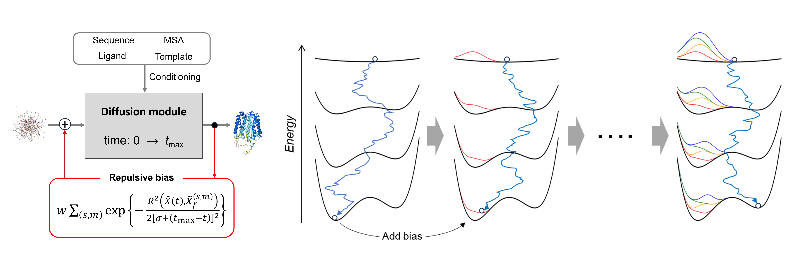

# AF3-ReD
[](https://doi.org/10.5281/zenodo.17985924)

AlphaFold 3 with Repulsive bias in the Diffusion generative model (AF3-ReD). AF3-ReD introduces a repulsive biasing potential between predicted structures during the denoising process of the diffusion model in AlphaFold3 (AF3), enabling the diffusion model to explore wider conformational space.

AF3-ReD is a derivative work of AF3, which is distributed under the Creative Commons Attribution-NonCommercial-ShareAlike 4.0 International (CC BY-NC-SA 4.0) license. Therefore, AF3-ReD is also provided under the same license.

## Usage

How to install and run AF3-ReD is essentially the same as the original AF3. For instruction, please refer to [the AF3 repository](https://github.com/google-deepmind/alphafold3).

> [!NOTE]   
> You can use the original AF3 model parameters because AF3-ReD requires no retraining and just adds the biasing potential to the energy landscape trained by the original AF3. To obtain the parameters, see  [the AF3 repository](https://github.com/google-deepmind/alphafold3).

In AF3-ReD, the gradient of the following Gaussian repulsive potential (i.e., the biasing force) is added to the denoising process.  
```math
V(\tilde{X}(t)) = w \sum_{(s,m)} \exp\left(-\frac{R^2(\tilde{X}(t), \tilde{X}_f^{(s,m)})}{2[\sigma + (t_{\max} - t)]^2}\right)
```
- $\tilde{X}(t)$ : The current Cα coordinates at time $t$ in the diffusion process
- ${\tilde{X}}\_f^{(s,m)}$ : The Cα coordinates of a previously predicted model (the $m$-th prediction with the $s$-th random seed) with the final time $t_{\max}$ (=160 in AF3)
- $R(\cdot)$ : Root-mean-squared deviation (RMSD)
- $w$ : The strength of the Gaussian potential
- $\sigma$ : The width of the Gaussian potential



### Inference

You can run your structure prediction with AF3-ReD using the following command:

```bash
python run_alphafold.py \
    --json_path=/root/af_input/fold_input.json \
    --model_dir=/root/models \
    --output_dir=/root/af_output \
    --bias_weight=100.0 \
    --bias_sigma=2.0
```

The last two arguments `--bias_weight` and `--bias_sigma`are specific to AF3-ReD and correspond to $w$ and $\sigma$, respectively.

> [!TIP]  
> - The parameter $\sigma$ typically works well around **1–2 Å**.
> - The optimal value of $w$ can vary depending on the protein target. We recommend trying multiple values to find a suitable weighting.
> - For the parameter settings used in our research, please refer to the AF3-ReD paper.

In the case of protein complexes, you can apply the biasing potential to only specific subunits using the following command:

```bash
python run_alphafold.py \
    --json_path=/root/af_input/fold_input.json \
    --model_dir=/root/models \
    --output_dir=/root/af_output \
    --bias_weight=100.0 \
    --bias_sigma=2.0 \
    --fit_all=False \
    --fit_chain=B,C
```

- `--fit_all`: Whether to use all chains for computing the biasing forces. When `True`, all chains are used for the superimposition and RMSD calculation, and biasing forces are applied to all chains. When `False`, specify the chain IDs with `--fit_chain`. (Default: `True`)
- `--fit_chain`: List of chain IDs used for computing the biasing forces when `--fit_all` is `False`. Only the specified chains are used for the superimposition and RMSD calculation, and the biasing forces are applied only to those chains.

> [!CAUTION]  
> **Application of the biasing potential to homo-multimers may not work properly** because chain ID assignments can vary between predictions (e.g., A–B vs. B–A in a homodimer). This issue will be addressed in a future release. 

To list other flags for the `run_alphafold.py` command, run `python run_alphafold.py --help`.

### Advanced Options

The following flags allow further control of the biasing potential. 
However, **changes from their default values have not been sufficiently evaluated**, so please use them with caution. For a detailed explanation of the method, please refer to the AF3-ReD paper.

- `--n_smooth <int>`: Integer specifying the number of neighboring residues to average the biasing forces. The averaging includes $n$ residues on each side plus the residue itself (a total of $2n + 1$ residues). (Default: `10`)
- `--bias_tmin <float>`: Noise level threshold for applying biasing forces. When the noise level ($= t_{max} - t$) falls below this value, no biasing force is applied. (Default: `2.0`)
- `--bias_restrict`: Whether to restrict biasing forces to structures within a certain RMSD threshold from the structures generated using the first random seed. (Default: `True`)
- `--cut_rmsd`: RMSD cutoff (Å) that defines the vicinity for applying biasing forces. Only effective when `--bias_restrict` is `True`. (Default: `0.5`)
- `--plddt_min <float>`: Minimum pLDDT threshold for applying biasing forces to residues. (Default: `60.0`)

AF3-ReD also allows users to modify the maximum number of MSA sequences (i.e., MSA depth) using the following flag:

- `--max_msa <int>`: Maximum number of MSA sequences. (Default: `16384`)

## Citing This Work

If you use AF3-ReD in your research, please cite the following paper as well as [the original AF3 paper](https://doi.org/10.1038/s41586-024-07487-w):

```bibtex
@article {Ohnuki2025,
	author = {Ohnuki, Jun and Okazaki, Kei-ichi},
	title = {Enhanced sampling of protein conformations in AlphaFold3 with repulsive bias in the diffusion generative model},
	elocation-id = {2025.12.17.693105},
	year = {2025},
	doi = {10.64898/2025.12.17.693105},
	publisher = {Cold Spring Harbor Laboratory},
	URL = {https://www.biorxiv.org/content/early/2025/12/18/2025.12.17.693105},
	eprint = {https://www.biorxiv.org/content/early/2025/12/18/2025.12.17.693105.full.pdf},
	journal = {bioRxiv}
}
```
